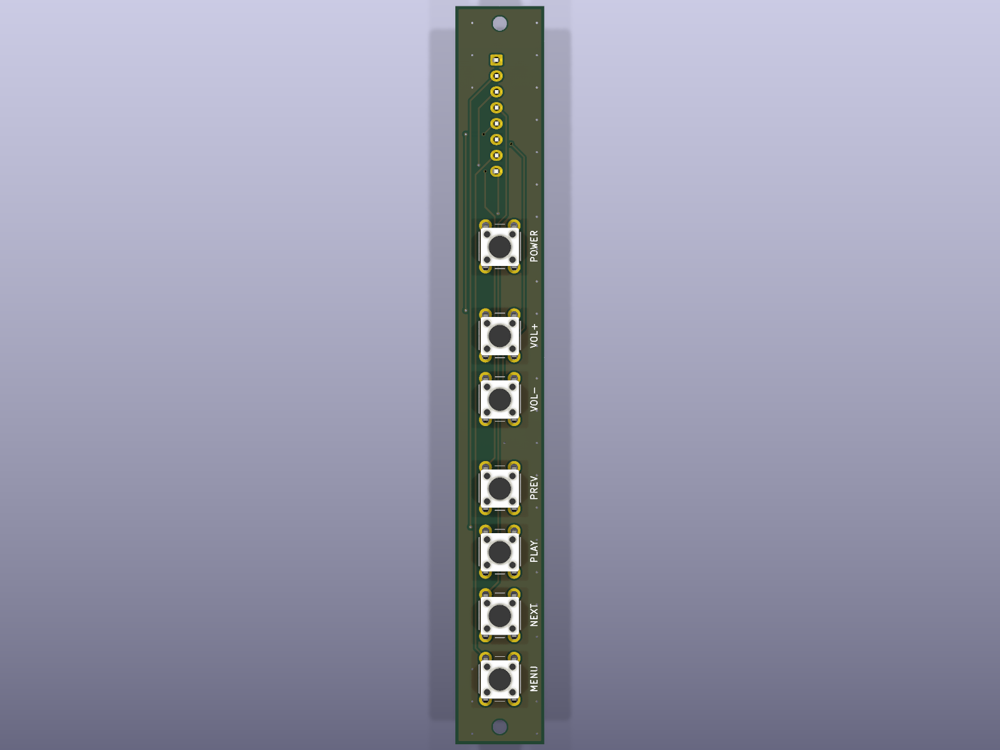
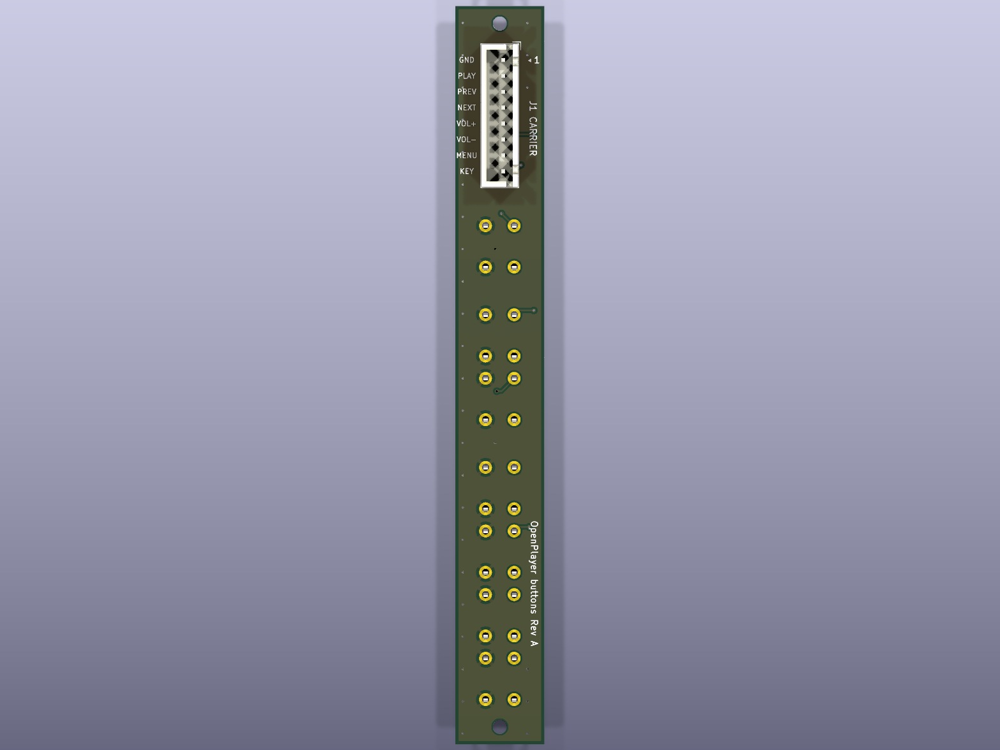

# OpenPlayer button board — Rev B

Side strip (SPEC 23; 6 keys since SPEC 25): six 6×6 mm tactile switches in one row and an 8-pin JST-XH to the carrier's J4. No active parts. Requirements: `docs/pcb-requirements.md` §4.7. The POWER key moved to the case's top edge, on the carrier's J7; Rev A (7 keys, 116 mm) is in git history only.




## Regenerate

Every KiCad file is generated. Do not edit `.kicad_sch` / `.kicad_pcb` by hand: change the scripts and rerun.

```powershell
python hardware\buttons\scripts\netlist.py        # self-check: J1 pinout = carrier J4 → OK
python hardware\buttons\scripts\build_sch.py      # → openplayer-buttons.kicad_sch
& "C:\Program Files\KiCad\10.0\bin\python.exe" hardware\buttons\scripts\build_pcb.py   # → .kicad_pcb (placed + routed)
.\hardware\common\export-fab.ps1 -Board buttons   # ERC + DRC, then Gerbers, drill, BOM, renders → fabrication/
```

| File | Role |
|---|---|
| `scripts/netlist.py` | Single source of truth: parts, footprints and nets; checks J1 against the carrier |
| `scripts/build_sch.py` | Writes the schematic |
| `scripts/build_pcb.py` | Outline, placement, silkscreen, routing, GND pour; size parameters |
| `../common/pcbgen.py` | Generator code shared with the carrier |
| `../common/export-fab.ps1` | Fabrication package; refuses to export on any ERC/DRC finding |

## Resize

Change the parameters at the top of `scripts/build_pcb.py` and rerun `build_pcb.py`; the length is computed and printed.

| Parameter | Default | Meaning |
|---|---|---|
| `BTN_PITCH` | 9.6 mm | Switch center to center within a group (≥ 9.6, the switch courtyard) |
| `GROUP_GAP` | 4 mm | Extra space between groups, and between J1 and the first switch |
| `GROUPS` | VOL+ VOL− \| PREV PLAY NEXT MENU | Order and grouping, top to bottom |
| `BOARD_W` | 14 mm | Strip width; widen it if routing fails |
| `END_MARGIN` | 5.5 mm | Last switch / connector to board end; the M2 holes sit here |

Default size 14 × 100.09 mm: fits the ≈ 104 mm inside height of the portrait case.

## Parts

| Ref | Part | Side |
|---|---|---|
| SW2–SW7 | 6×6 mm THT tactile (`SW_PUSH_6mm`), VOL+, VOL−, PREV, PLAY, NEXT, MENU top to bottom (no SW1) | Front (toward the side wall) |
| J1 | `CARRIER`, JST-XH 8 (B8B-XH-A), pin 1 at the top | Back, top end |
| H1, H2 | M2 mounting holes, one at each end | — |

Switch height (4.3–13 mm) is chosen when buying, to suit the button holders; every `SW_PUSH_6mm_H*` variant uses the same pads.

## Pinout and cable

J1 has the same pinout as the carrier's J4, so the cable is **XH-8 to XH-8, straight: pin 1 to pin 1** (not reversed).

| J1 pin | Net | Button | Carrier J4 pin |
|---:|---|---|---:|
| 1 | GND | common | 1 |
| 2 | BTN_PLAY | PLAY (SW5) | 2 |
| 3 | BTN_PREV | PREV (SW4) | 3 |
| 4 | BTN_NEXT | NEXT (SW6) | 4 |
| 5 | BTN_VOLUP | VOL+ (SW2) | 5 |
| 6 | BTN_VOLDN | VOL− (SW3) | 6 |
| 7 | BTN_MENU | MENU (SW7) | 7 |
| 8 | — (no-connect, silkscreen `NC`) | — | 8 (PWR_KEY) |

- Each switch shorts its signal to GND. Pull-ups and debounce are on the Pi side (internal pull-ups, `debounceSeconds`).
- Pin 8 stays in the connector so the XH-8 cable is unchanged; the carrier still routes PWR_KEY to it. POWER is a panel key on J7 of the carrier (module `K` pad, not a GPIO). Shut down with a 3 s hold on PLAY.
- Pin 1 is marked on both boards. Check continuity pin by pin before connecting the cable.
