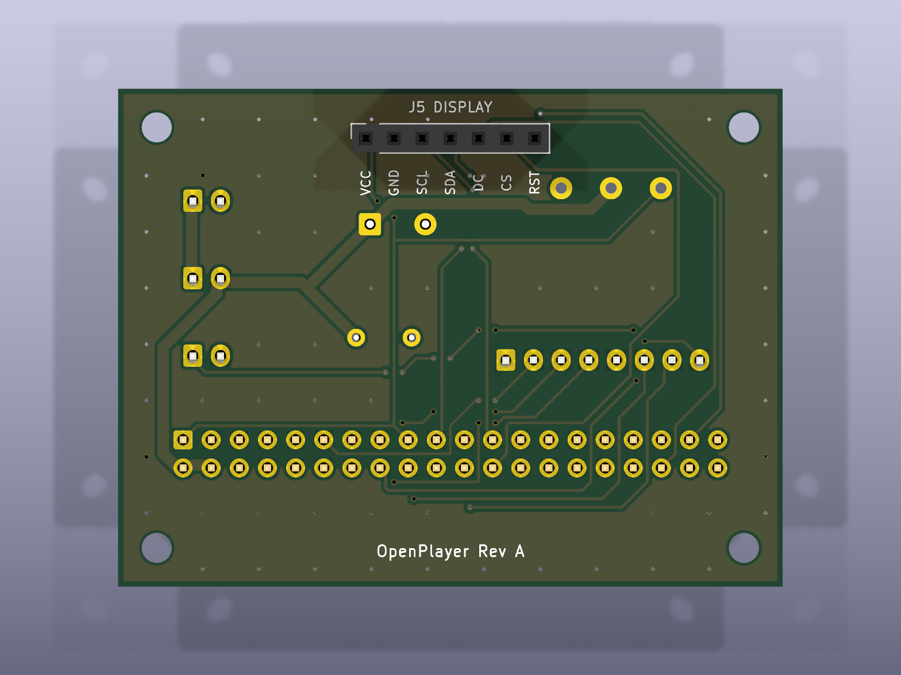
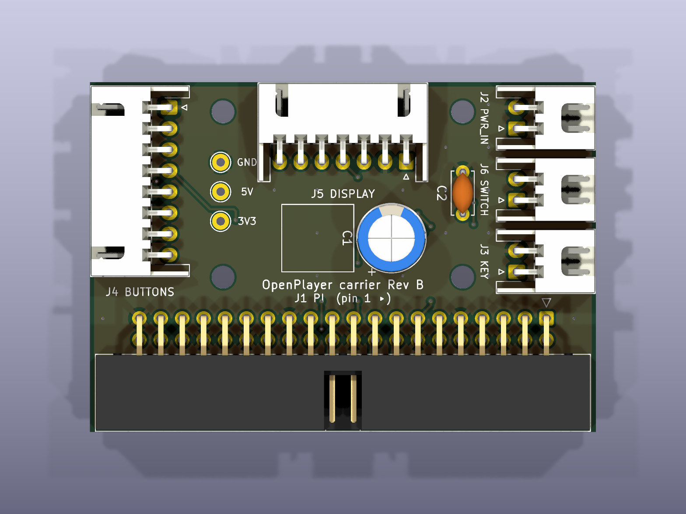

# OpenPlayer carrier PCB — Rev A

Bridge board (SPEC 22): connectors only, no active parts. It joins the Pi Zero 2 W (via a 40-pin IDC ribbon), the GC9A01 display, the button board, the FM5324GA charge/boost module and a panel power switch. Requirements: `docs/pcb-requirements.md`.




> **Never plug power into the Pi's micro-USB port while the ribbon is connected.** The board feeds the Pi through header pins 2 and 4.

## Regenerate

Every KiCad file is generated. Do not edit `.kicad_sch` / `.kicad_pcb` by hand: change the scripts and rerun.

```powershell
python hardware\pcb\scripts\netlist.py        # self-check against config/player.example.json → OK
python hardware\pcb\scripts\build_sch.py      # → openplayer-carrier.kicad_sch
& "C:\Program Files\KiCad\10.0\bin\python.exe" hardware\pcb\scripts\build_pcb.py   # → .kicad_pcb (placed + routed)
.\hardware\common\export-fab.ps1 -Board pcb   # ERC + DRC, then Gerbers, drill, BOM, renders → fabrication/
```

| File | Role |
|---|---|
| `scripts/netlist.py` | Single source of truth: parts, footprints and nets |
| `scripts/build_sch.py` | Writes the schematic (stock KiCad 10 symbols, net labels per pin) |
| `scripts/build_pcb.py` | Outline, placement, silkscreen, routing (grid router), GND pours |
| `../common/pcbgen.py` | Generator code shared with the button board: schematic writer, placement, grid router, GND pour |
| `../common/export-fab.ps1` | Fabrication package for any board (`-Board pcb`); refuses to export on any ERC/DRC finding |

- **Change a pin:** edit `NETS` in `netlist.py`. If it is a GPIO, change `config/player.example.json` too; the self-check fails until both agree.
- **Resize the board:** change `BOARD_W` / `BOARD_H` in `build_pcb.py` and rerun. Placement is anchored to the edges and the center. 60 mm is the minimum width (the 2×20 header is ~56 mm). Tested at 60 × 45 and 70 × 52.
- Order at JLCPCB with `fabrication/openplayer-carrier-gerbers.zip` (2 layers, 1.6 mm, defaults).

## Connectors

All on the back except J5. Pin 1 is marked on the silkscreen.

| Ref | Name | Type | Pins |
|---|---|---|---|
| J1 | PI | 2×20 shrouded IDC, straight ribbon to the Pi | J1 pin N = Pi pin N |
| J2 | PWR_IN | JST-XH 2 | 1 5V (module `5V +`), 2 GND (module `−`) |
| J3 | KEY | JST-XH 2 | 1 PWR_KEY (module `K`), 2 GND |
| J4 | BUTTONS | JST-XH 8 | 1 GND, 2 PLAY (GPIO17), 3 PREV (GPIO27), 4 NEXT (GPIO22), 5 VOL+ (GPIO23), 6 VOL− (GPIO24), 7 MENU (GPIO25), 8 PWR_KEY |
| J5 | DISPLAY | 1×7 female 2.54 mm, front | 1 VCC 3V3, 2 GND, 3 SCL (GPIO11), 4 SDA (GPIO10), 5 DC (GPIO16), 6 CS (GPIO8/CE0), 7 RST (GPIO26) |
| J6 | SWITCH | JST-XH 2, to a ≥ 3 A panel switch | 1 5V_IN, 2 5V_SYS |

- `PWR_KEY` goes only to the module's `K` pad; it is not a Pi GPIO.
- The battery connects straight to the module, never to this board.
- C1 (470–1000 µF / 10 V) is optional: populate it if the Pi resets when USB-C is plugged in.
- Test points: TP1 GND, TP2 5V_SYS, TP3 3V3.

## Bring-up

See the checklist in `docs/pcb-requirements.md` §9. Power up first without the Pi, check 5 V at TP2 with the switch on and 0 V with it off, and only then connect the ribbon.
